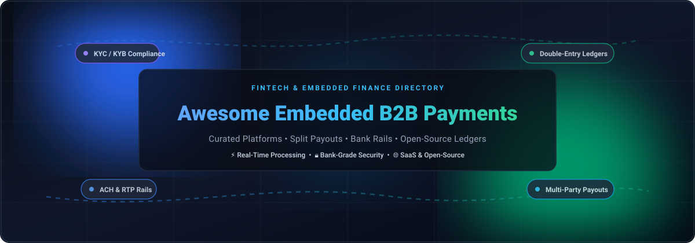

  

# 💳 Awesome Embedded B2B Payment Processing 🚀

  
  
  

> 🌟 A definitive curated catalog of **Embedded B2B Payment Processing** systems, multi-party payout engines, bank rails (ACH, RTP, FedNow), double-entry ledgers, and self-hosted financial infrastructure.

**Top Embedded B2B Payment Processing (SaaS & Open-Source) 🌟 Star if you like it! 🌟**

*Focused on Platform Payments 💸, Multi-Party Split Disbursements 🔄, Bank Transfers 🏦, and Self-Hosted Financial Architecture 🛠️.*

**Last updated: November 2026 📅**

---

This repository tracks notable **SaaS platforms** ☁️ and **open-source developer tools** 💻 for **Embedded B2B Payment Processing**. These technologies empower software platforms, B2B marketplaces, and vertical SaaS providers to natively embed payment capabilities—orchestrating merchant onboarding, automated split disbursements, regulatory compliance (KYC/KYB/AML), and multi-rail funds settlement without having to become a licensed payment facilitator themselves.

---

## 📑 Table of Contents

- [📊 Sector Overview & Market Dynamics](#-sector-overview--market-dynamics)
- [☁️ SaaS & Hosted Platforms](#️-saas--hosted-platforms)
- [💻 Open-Source GitHub Projects](#-open-source-github-projects)
- [🏗️ Architecture Comparison: SaaS vs. Self-Hosted Infrastructure](#️-architecture-comparison-saas-vs-self-hosted-infrastructure)
- [🤝 How to Contribute](#-how-to-contribute)
- [💖 Support](#-support)
- [⭐ Star History](#-star-history)
- [⚖️ Disclaimer & Regulatory Considerations](#️-disclaimer--regulatory-considerations)

---

## 📊 Sector Overview & Market Dynamics

The global embedded B2B finance and payment processing market is estimated at **$85B–$185B** as of 2025–2026, and is projected to facilitate over **$16 Trillion** in embedded transaction volume by 2030 as enterprises replace legacy manual invoicing, paper checks, and disjointed ERP workflows with native software-driven payment rails 🚀.

The sector exhibits **moderate fragmentation with high concentration at the tier-1 infrastructure layer**: mega-scale platforms (Stripe, Adyen, and PayPal) dominate standard card acquiring and global marketplace compliance ("winner-take-most" dynamics for global digital commerce), while specialized payment rails (such as Dwolla and Moov for account-to-account ACH/RTP, Plaid for bank identity, and Finix for full-stack custom PayFac enablement) sustain a highly competitive ecosystem serving mid-market SaaS and niche vertical software platforms 📈.

---

## ☁️ SaaS & Hosted Platforms

| Product / Platform | Company Size (Valuation / Revenue) 🏢 | Pricing Model & Starting Rates 🏷️ | Free Tier / Free Trial Limits 🎁 | Key Use Cases & Target Audience 🎯 |
| :--- | :--- | :--- | :--- | :--- |
| [**Stripe Connect**](https://stripe.com/connect) | **$159B Valuation** (2026 tender offer; ~$6.8B+ annual revenue) | **$0/mo** platform fee if Stripe sets seller pricing; or **$2/mo per active account** + **0.25% + $0.25 per payout** (US) when platforms set custom pricing. Card processing starts at **2.9% + $0.30** domestic, instant payouts at 1%. | **Free tier available forever** (no monthly platform fees when Stripe handles direct merchant pricing; free unlimited sandbox testing environment). | Marketplaces, software platforms, and multi-sided networks seeking turnkey merchant onboarding (Accounts v2), global compliance, and multi-currency split payouts. |
| [**PayPal B2B / Complete Payments**](https://www.paypal.com/us/business) | **~$46B Market Cap** (Public: NASDAQ: PYPL; ~$31B+ annual revenue) | **No monthly base fee**; domestic transactions start at **2.59% to 2.99% + $0.49**; cross-border / international commercial payments start at **4.40% + fixed fee + 3.0%–4.0% FX markup**. | **Free tier available forever** ($0/month recurring software fees; free unlimited developer sandbox with mock test accounts). | B2B merchants and platforms already embedded in the PayPal/Venmo ecosystem requiring global invoice collection and recognized brand checkouts. |
| [**Adyen for Platforms**](https://www.adyen.com/platforms) | **~$30B Market Cap** (€28B Euronext: ADYEN; ~$2B+ net revenue) | **Interchange++ pricing model**: wholesale interchange + card scheme fees + **0.48%–0.60% processing markup + €0.10–€0.12 ($0.11) fixed transaction fee**; monthly minimum platform invoice applies (~€100–€500/mo). | **Free developer sandbox test account** (no production free tier; test Customer Area provides full API credential access, mock payment simulations, and webhook testing). | Large enterprise marketplaces and global unified commerce platforms requiring unified in-store POS and omnichannel split disbursements. |
| [**HubSpot Payments**](https://www.hubspot.com/products/payments) | **~$12B Market Cap** (Public: NYSE: HUBS; ~$2.5B+ annual revenue) | **0.5% platform fee** per transaction (free platform fee promotion in year 1; ACH capped at $10) or **0.75% platform fee** when bringing custom connected Stripe accounts, plus **2.9%** standard card processing rates. | **Free tier available** (free CRM tier includes basic invoicing and payment links for up to 2 users; live payments incur per-transaction processing fees). | B2B SMBs and sales teams utilizing HubSpot CRM for CPQ, digital quotes, recurring subscriptions, and client billing directly inside CRM records. |
| [**Plaid**](https://plaid.com/) | **$8.0B Valuation** (Secondary market tender offer; $300M+ ARR) | **Pay-as-you-go plan**: **$0/mo base fee** with per-request fees (typically starting at **$0.30–$1.50 per Auth / Balance check**); Growth tiers require annual minimum spend commitments. | **Free trial tier**: Includes **10 free live production items** (real connected bank accounts) for testing, plus an unlimited free Sandbox testing environment. | Platforms requiring instant bank account verification, real-time balance checks, and fraud screening prior to initiating ACH/RTP/FedNow B2B transfers. |
| [**Melio**](https://www.meliopayments.com/) | **$2.5B Valuation** (Acquired by Xero in 2025; $100M+ revenue) | **$0/mo ("Go" plan)** with **5 free ACH transfers/month** (then **$0.50 per additional ACH**); paid plans start at **$25/mo ("Core" plan)** for 20 free ACH transfers/mo and two-way sync; credit card payments incur 2.9%. | **Free tier available forever ("Go" plan)**: Includes **5 free ACH bank transfers every month** (limited to 1 user; first 10 accounting syncs included). | Small-to-medium businesses, accounting firms, and platforms seeking streamlined accounts payable (AP), invoice scheduling, and vendor card-to-bank disbursements. |
| [**Dwolla**](https://www.dwolla.com/) | **~$500M Valuation** (Acquired by NMI in 2026; $76.9M total funding raised) | **Custom volume-based tier pricing**: Commercial tiers typically start at **$100 to $500+/mo base platform fee** with tiered per-transaction costs decreasing with volume across ACH, Same-Day ACH, RTP, and FedNow. | **Free developer sandbox environment** (no production free tier; free unlimited sandbox access mirroring production rails, webhooks, and account simulation). | High-volume B2B platforms, enterprise disbursement engines, and payroll systems requiring dedicated, predictable bank transfer infrastructure without per-API-call penalties. |
| [**Helcim**](https://www.helcim.com/) | **~$185M Valuation** ($250M CAD post Series C in Aug 2026; $150M+ CAD ARR) | **$0/mo base subscription fee** (no contract, no setup fee); transparent **Interchange + 0.40% + $0.08** (in-person) and **Interchange + 0.50% + $0.25** (online/invoicing for ≤$50K/mo, automatic volume discounts above). | **Free tier available forever** (no monthly account, setup, or PCI compliance fees; pay strictly on processing volume with zero minimums). | Growing SMBs, wholesale suppliers, and B2B merchants requiring wholesale interchange-plus pricing without recurring SaaS subscription locks. |
| [**Finix**](https://www.finix.com/) | **~$210M Total Funding** (Series C led by Acrew Capital & Lightspeed) | **Interchange-Plus direct merchant pricing**: **Interchange + 0.00% markup + $0.15** per transaction (Visa/Mastercard/Discover) and standard ACH at **1.00% (max $10 cap) + $0.25**; platform membership plans start around **$79 to $250/mo**. | **Free developer sandbox environment** (no production free tier; free sandbox keys, simulator tools, and documentation for onboarding/payment flows). | Software platforms, SaaS companies, and emerging PayFacs transitioning from traditional ISO/sub-merchant processing to owning their payment monetization stack. |
| [**Moov Financial**](https://moov.io/) | **~$150M–$250M Valuation** ($149M total funding from a16z & Commerce Ventures) | **$500/mo minimum platform spend**; domestic card processing at **Interchange + 0.60% + $0.15**; standard ACH at **$0.40/transfer**; instant payments at **0.95%** ($0.50 min, $5 cap); KYB at **$4.50/biz**, KYC at **$2.50/user**. | **Free developer test mode / sandbox** (no production free tier; sandbox allows instant simulated ACH/card flows, pre-verified business entities, and test API keys). | Developer-centric software platforms and fintech engineers demanding modular, cloud-native money movement APIs and fully documented interchange-plus pricing. |

---

## 💻 Open-Source GitHub Projects

The following open-source frameworks, financial ledgers, and payment routing engines enable developers to build, orchestrate, and audit embedded payment systems without vendor lock-in 🔓.

*Sorted by GitHub_Stars_Count (descending):*

| Project & Repository 📦 | GitHub_Stars_Badge ⭐ | License 📜 | Tech Stack 🛠️ | Primary Architecture & Embedded B2B Capabilities 💡 |
| :--- | :--- | :--- | :--- | :--- |
| [**Hyperswitch**](https://github.com/juspay/hyperswitch) |  | Apache-2.0 | Rust 🦀 | High-performance open-source payment switch and orchestrator connecting 100+ processors (Stripe, Adyen, Braintree) through a unified API with smart dynamic routing and unified dispute workflows. |
| [**BTCPay Server**](https://github.com/btcpayserver/btcpayserver) |  | MIT | C# / .NET ⚡ | Self-hosted, secure, and open-source payment processor enabling censorship-resistant crypto settlement, multi-store checkout, and automated B2B invoicing with zero third-party intermediaries. |
| [**Kill Bill**](https://github.com/killbill/killbill) |  | Apache-2.0 | Java ☕ | Battle-tested open-source subscription billing and payments engine designed for complex enterprise B2B product catalogs, usage metering, multi-tenant invoices, and multi-gateway payment routing. |
| [**Formance Ledger**](https://github.com/formancehq/ledger) |  | Apache-2.0 | Go 🐹 | Programmable financial core ledger built for high-throughput money movement, real-time balance tracking, and immutable multi-party double-entry bookkeeping using the Numscript DSL. |
| [**Blnk**](https://github.com/blnkfinance/blnk) |  | Apache-2.0 | Go 🐹 | Open-source core ledger and financial orchestration engine providing immutable double-entry bookkeeping, multi-currency wallet management, transaction scheduling, and external reconciliation. |
| [**Moov ACH**](https://github.com/moov-io/ach) |  | Apache-2.0 | Go 🐹 | High-performance Go parser, validator, and generator for NACHA Automated Clearing House (ACH) files, enabling platforms to interface directly with direct-to-bank transfer clearing networks. |
| [**Moov Watchman**](https://github.com/moov-io/watchman) |  | Apache-2.0 | Go 🐹 | Lightweight, low-latency AML sanctions screening service searching regulatory watchlists (U.S. OFAC SDN, PEP lists, BIS) to satisfy KYC/KYB compliance during merchant onboarding. |
| [**Formance Stack**](https://github.com/formancehq/stack) |  | Apache-2.0 | Go / TypeScript 🌐 | The complete modular open-source financial operating system, combining the Formance Ledger, multi-gateway payment connectivity, and automated reconciliation orchestration. |
| [**Moov Paygate**](https://github.com/moov-io/paygate) |  | Apache-2.0 | Go 🐹 | RESTful money movement gateway designed to coordinate multi-rail bank transfers (FedNow, RTP, ACH) and internal account balances with integrated audit logs. |
| [**TPT Pay**](https://github.com/tpt-solutions/tpt-payments) |  | MIT | Go 🐹 | Open-source, self-hostable Stripe-compatible REST payment API backed by a PostgreSQL double-entry ledger, HashiCorp Vault tokenization, and extensible acquiring adapters. |
| [**Business Commerce Protocol (BCP)**](https://github.com/beamio-APP/bcp) |  | Apache-2.0 | Solidity / TS ⛓️ | Decentralized smart contract and agent commerce protocol defining structured commerce handshakes (INTENT, QUOTE, COMMIT), programmable multi-party escrow, and on-chain settlement. |

---

## 🏗️ Architecture Comparison: SaaS vs. Self-Hosted Infrastructure

When selecting an embedded B2B payment architecture, organizations typically evaluate four architectural tiers:

```mermaid
flowchart TD
    subgraph SaaS ["Fully-Managed SaaS Platforms"]
        A["Stripe Connect / Adyen"] -->|Managed KYC & Global Acquiring| B["Marketplaces & Platforms"]
    end

    subgraph Rails ["Bank API & Rail Aggregators"]
        C["Dwolla / Moov / Finix"] -->|ACH, RTP, FedNow Rails| D["Custom Platform Wallets"]
    end

    subgraph Orchestration ["Open-Source Orchestration & Routing"]
        E["Hyperswitch / Kill Bill"] -->|Multi-Processor Failover & Catalog| F["Aggregated Gateways"]
    end

    subgraph Ledgers ["Self-Hosted Core Ledgers"]
        G["Formance / Blnk / Moov-io"] -->|Immutable Double-Entry Ledger| H["Audit & Settlement Engine"]
    end
```

---

## 🤝 How to Contribute

Contributions are welcome and highly encouraged! To contribute:

1. 🍴 Fork this repository.
2. 🌿 Create a new branch: `git checkout -b feature/new-payment-tool`.
3. 📝 Add your entry following the established table format (include pricing, free tier limits, company metrics, and direct links).
4. 🔍 Verify all GitHub repo links, Stars_Badges, and markdown tables render cleanly.
5. 🚀 Submit a descriptive Pull Request with relevant documentation or release references.

---

## 💖 Support

Thank you for exploring and utilizing this curated directory! If you found this repository helpful:

- ⭐ **Star** this repository to show your appreciation and help others discover it.
- 🍴 **Fork** and contribute new platforms, ledgers, or documentation updates.
- 📢 **Share** with colleagues, developers, and fintech teams building embedded finance products.
- ☕ **Buy a Coffee / Sponsor**: If you would like to support ongoing maintenance and research, consider sponsoring via the [GitHub Sponsors Dashboard](https://github.com/sponsors/ishandutta2007).

---

##  Star History

---

## ⚖️ Disclaimer & Regulatory Considerations

- **Informational Purposes Only:** This repository is maintained as a curated community directory and does not constitute formal legal, financial, or compliance advice.
- **Regulatory & Licensing Compliance:** Deploying payment infrastructure or holding merchant balances touches regulated financial activity. Moving real money and storing sensitive cardholder data mandates adherence to **PCI DSS Level 1**, **FinCEN / BSA AML regulations**, and state **Money Transmitter Licenses (MTL)**.
- **Open-Source Responsibility:** Open-source ledgers (Formance, Blnk) and payment gateways (Hyperswitch, TPT Pay) provide raw software logic; they **do not** confer money transmission licenses or card network sponsorships. Live deployment requires formal partnerships with chartered financial institutions or acquiring banks.
- **Take-Rate Economics:** When implementing embedded platforms like Stripe Connect or Adyen, platforms must account for multi-tier fee stacking (platform percentage + fixed per-transaction fees + monthly active account fees + payout fees) against total gross merchandise volume (GMV) to preserve net take-rate margins.
